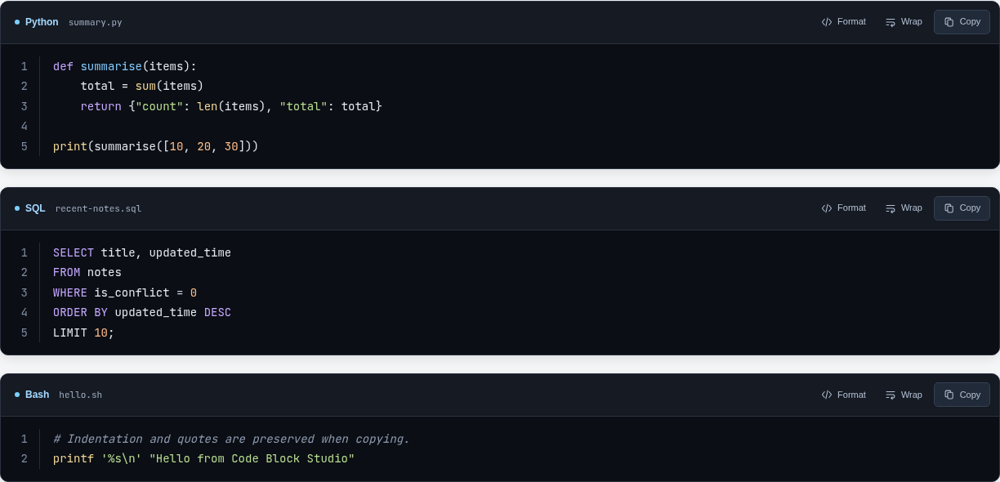
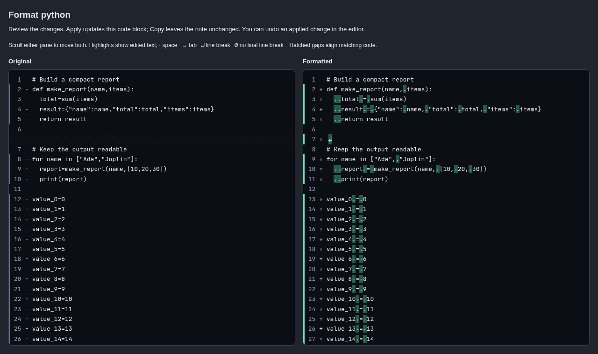
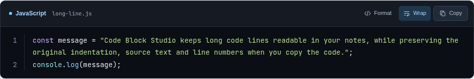

# Code Block Studio for Joplin

Read, compare and tidy code in your notes.

Code Block Studio turns fenced code blocks in Joplin Desktop into readable dark cards, with syntax highlighting, line numbers, optional filenames and the bundled JetBrains Mono font. Format, Wrap and Copy stay within reach as you scroll through long snippets.

Preview formatting for Python, Bash, JavaScript, TypeScript, SQL, Go, C/C++ and other supported languages before changing a note. The Original and Formatted panes scroll together, keep matching code aligned, and show the spaces, tabs and line breaks that changed. Apply the result to one code block, copy it instead, or cancel. Normal editor Undo restores an applied change.

All highlighting and formatting run locally. There are no accounts, AI services, analytics or runtime downloads, and snippets are never executed.

**Concept and design: Leonard Powers.** **Coding and implementation: Ada (OpenAI Codex), under Leonard Powers' direction.** See [credits](CREDITS.md).





These images show the actual plugin renderer and comparison components in Chromium with fictional sample code. They are component screenshots, rather than captures of a complete Joplin window.

## Use it

Code Block Studio applies to fenced code blocks in Joplin's **Rich Text editor** and **Markdown preview**. The Markdown source editor stays an editable source view.

In the Markdown editor, enter:

````markdown
```python title="hello.py"
def greet(name: str) -> str:
    return f"Hello, {name}!"

print(greet("Joplin"))
```
````

Specify a language such as `python`, `javascript`, `typescript`, `bash`, `powershell`, `sql`, `json`, `html`, `css`, `yaml`, `cpp` or `rust` for reliable colours. Highlight.js includes many more languages and aliases. Untagged fences can detect a language; this is a best guess. Use `text` to disable highlighting for a block. Unknown language names display safely as plain text. Existing Mermaid, maths and common diagram fences are delegated to Joplin or their own plugins.

- **Copy** puts the original code on the clipboard, including indentation, blank lines and the final newline. It excludes numbers, language labels and filenames. A successful write shows “Copied”; an error shows “Retry”.
- **Wrap** toggles long-line wrapping separately for each card. A wrapped line keeps one line number. The per-card toggle lasts until the note is rendered again.
- **Format** opens an Original / Formatted preview for supported languages. Scroll either pane to move both together. Matching code stays aligned even when formatting adds lines, with line numbers and hatched gaps for the extra rows. Both panes keep a black background: grey highlights show removed text in the original, and green highlights show additions in the formatted code. Changed spaces appear as `·`, tabs as `→`, added/removed line breaks as `↵`, and a changed missing final line break as `∅`. Choose **Apply formatting** to update only that code block, or **Copy formatted** / **Copy original** to copy without editing the note. **Cancel** leaves it unchanged. Use the editor's normal **Undo** to restore an applied change.
- The toolbar stays at the top of the note view while scrolling through a long code block, keeping Format, Wrap and Copy within reach. It moves away when you scroll past that block.
- **`title="hello.py"`** is optional and adds a filename to the header.
- Short inline snippets also get a dark background and code font.



## How it works

Add an ordinary Markdown code fence with a language label. The plugin styles that block in the rendered note, and Copy reads the preserved source text. Highlighting does not rewrite the code.

When you choose Format, a bundled formatter processes that block on your device and opens the comparison. Added display gaps and whitespace symbols help you review the changes; they are excluded from copied and applied code. Apply checks the target and updates the selected block through the active editor, retaining normal Undo. Notes continue to use ordinary Markdown when the plugin is removed.

Formatting is available for explicitly labelled code blocks:

| Languages | Fence labels and aliases |
| --- | --- |
| Python | `python`, `py` |
| Bash and POSIX shell | `bash`, `sh`, `shell`, `shellscript` |
| Go | `go`, `golang` |
| C, C++, C#, Java, Objective-C, Protocol Buffers | `c`, `cpp` / `c++`, `csharp` / `cs` / `c#`, `java`, `objc`, `proto` / `protobuf` |
| SQL dialects | `sql`, `postgresql` / `postgres` / `pgsql`, `mysql`, `mariadb`, `sqlite`, `tsql`, `bigquery` |
| JavaScript and TypeScript | `javascript` / `js`, `jsx`, `typescript` / `ts`, `tsx` |
| Web templates and styles | `html`, `vue`, `angular`, `css`, `scss`, `less` |
| Data and configuration | `json`, `jsonc`, `json5`, `yaml` / `yml`, `xml`, `svg`, `toml` |
| Other | `php`, `graphql` / `gql`, `markdown` / `md` |

Use `bash` for Bash-specific scripts and `sh` for POSIX shell scripts. Languages without a bundled formatter, including PowerShell, Rust, Fish and Zsh, retain highlighting and copying; their Format button is omitted. Guessed languages also omit Format, so add an explicit fence label to enable it.

All formatters are bundled and run locally when requested. Python uses Ruff with four-space indentation and preserved quote style; shell uses shfmt with two spaces; Go uses gofmt's standard style. C-family code uses clang-format (Microsoft style for C#, LLVM style with two spaces for the others). SQL uses uppercase keywords and two-space indentation. Prettier handles the remaining languages, generally using two spaces and a preferred width of 100 columns. XML preserves whitespace-sensitive mixed content. Code uses LF line endings after formatting.

Formatting changes layout, not program execution: snippets are never run, shell simplification is disabled, and Python docstring examples are left alone. A parsing failure displays an error without changing the code; formatters do not replace a compiler or validate every language error. Clicking Format on already-formatted code shows “Already formatted” directly below the toolbar buttons. Formatting feedback stays with the sticky toolbar as you scroll, and Format remains available. No system Python, shell formatter, Go compiler or C compiler installation is required.

Open **Tools → Code Block Studio: Open welcome and examples** to create or reopen the example note. The first invocation adds one note to the selected notebook. Reopening it does not replace your edits.

## Preferences

Under **Tools → Options → Code Block Studio**, choose line numbers, default wrapping, code font size (10–24px), language detection and inline styling. If an existing view does not immediately refresh, switch to another note and back.

Code Block Studio is independent of the Joplin theme, so the cards stay dark in a light or dark notebook. The font ships inside the plugin; no font download or system installation is needed. Code and highlighting stay on the device. There are no network requests or analytics in the plugin.

## Install or remove

Requires Joplin Desktop; the declared minimum is 3.3. Earlier versions were checked on Joplin Desktop 3.7.22 for Linux. Final live acceptance of the current candidate, and verification of the minimum version, remain pending. Windows, macOS and mobile have not been live-tested; mobile is not declared as supported.

This is a publication candidate and is not yet listed in the official plugin catalogue. Download the preview installer from [GitHub Releases](https://github.com/HumuHumuUK/codeblock-studio/releases), then install it manually:

1. Open **Tools → Options → Plugins**.
2. Choose the gear menu → **Install from file** and select `local.lpowers.code-studio.jpl`.
3. Restart Joplin.

Download the actual `.jpl` installer file, rather than saving a repository's file-view web page. A fresh local build is available under `publish/`.

Disable overlapping code-block appearance plugins if they interfere with the cards.

To remove Code Block Studio, disable or uninstall it under Plugins and restart. Notes remain ordinary Markdown. The example note can be deleted separately.

## Build from source

Use a current Node.js LTS release and npm:

```sh
npm ci
npm run typecheck
npm run build
npm test
```

The build creates `publish/local.lpowers.code-studio.jpl` and its checksum. It uses the official Joplin API declarations and API global, bundles the implementation with esbuild, and creates the same plain tar archive format as Joplin's plugin generator.

The browser interaction test expects Chromium at `/usr/bin/chromium`; adjust that path in `tests/viewer.test.mjs` for another OS. Runtime code has no dependency on Chromium or Node being installed separately from Joplin.

## Project files

- [Development guide](docs/DEVELOPMENT.md) — setup, build, tests and release checks.
- [Architecture](docs/ARCHITECTURE.md) — rendering, formatting, copying and editor integration.
- [Plugin listing](docs/PLUGIN-LISTING.md) — reusable catalogue description and screenshot captions.
- [Publication preparation](docs/PUBLISHING.md) — package checks, current submission guidance and remaining decisions.
- [Change history](CHANGELOG.md) and [credits](CREDITS.md).
- [Examples](examples/code-block-studio.md) for trying the supported formatters.
- `publish/` contains the current local build, catalogue metadata and checksums after building from source.

Local working files, research snapshots and installation backups are excluded from public distribution.

## Compatibility and behaviour

- Rendering does not modify note contents. Applying a formatting preview explicitly edits the chosen code block through the active editor, preserving Undo. Joplin's documented `joplin-editable` and `joplin-source` metadata preserves source when Rich Text converts the note back to Markdown.
- Syntax colours cover recognised languages; formatting is available for the explicitly labelled languages listed above.
- Print styles wrap code, retain colours and hide the toolbar buttons.
- The bundled font covers Latin text. Other scripts and emoji use the platform's fallback fonts.
- Standard fenced blocks are styled; arbitrary HTML `<pre>` elements and indented code blocks are left to Joplin.
- Diagram language names excluded from styling: `mermaid`, `math`, `katex`, `abc`, `plantuml`, `drawio`, `graphviz`, `dot`, `nomnoml`, `markmap`.

## Support development

If Code Block Studio is useful to you, you can [buy me a coffee on Ko-fi](https://ko-fi.com/W4J72A4KLF). Support is entirely optional.

## Sources and licences

Original plugin implementation: MIT, see `LICENSE`. Bundled dependency notices are included in the plugin archive.

- [Joplin plugin development](https://joplinapp.org/help/api/get_started/plugins/)
- [Joplin Markdown renderer API and Rich Text round-trip metadata](https://joplinapp.org/api/references/plugin_api/enums/contentscripttype.html)
- [Highlight.js](https://github.com/highlightjs/highlight.js) — BSD 3-Clause
- [JetBrains Mono](https://github.com/JetBrains/JetBrainsMono) — SIL Open Font License 1.1
- [Prettier](https://prettier.io/docs/browser/) — MIT, with bundled third-party notices
- [Ruff formatter for WebAssembly](https://github.com/wasm-fmt/ruff_fmt) — MIT, with Ruff notices
- [shfmt for WebAssembly](https://github.com/wasm-fmt/shfmt) and [gofmt for WebAssembly](https://github.com/wasm-fmt/gofmt) — bundled upstream and Go/TinyGo notices
- [clang-format for WebAssembly](https://github.com/wasm-fmt/clang-format) — includes LLVM Apache 2.0 with LLVM exceptions
- [SQL Formatter](https://github.com/sql-formatter-org/sql-formatter), [Prettier XML](https://github.com/prettier/plugin-xml), [Prettier TOML](https://github.com/un-ts/toml-tools/tree/master/packages/prettier-plugin-toml) and [Prettier PHP](https://github.com/prettier/plugin-php) — bundled dependency licences
- [jsdiff](https://github.com/kpdecker/jsdiff) — local comparison of code lines and characters, BSD-3-Clause
- [Markdown-it](https://github.com/markdown-it/markdown-it) — MIT, used to locate the chosen block in the current Markdown editor document

This is an independent plugin, not a fork of CodePerfect. Its source was consulted as a comparison, alongside the official Joplin API.
